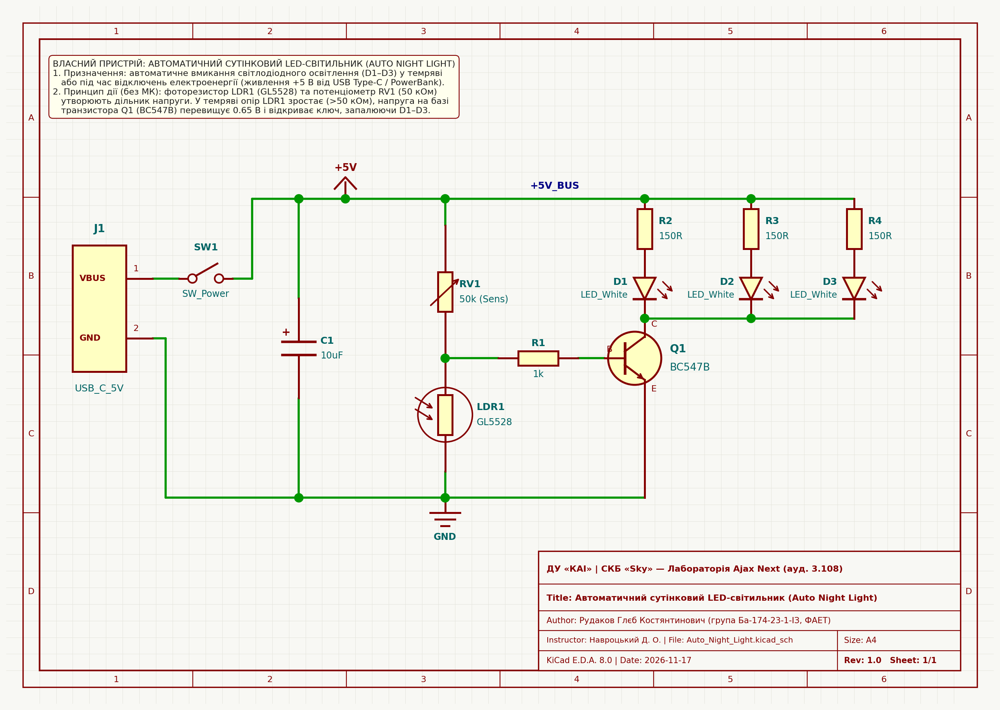
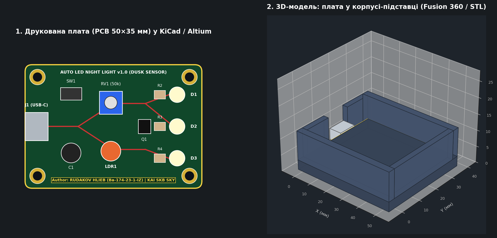

# Автоматичний сутінковий LED-світильник (Auto LED Night Light)

Індивідуальний проєкт з вибіркової дисципліни **«Проєктна робота в СКБ «Sky»»** (осінь 2026, лабораторія **Ajax Next 3.108**).

- **Студент:** Рудаков Глєб Костянтинович
- **Група:** Ба-174-23-1-ІЗ (ФАЕТ, кафедра АСУ, ДУ «Київський авіаційний інститут»)
- **Викладач:** Навроцький Денис Олександрович
- **САПР:** KiCad EDA 8.0 (схема і друкована плата) / Fusion 360 (3D-корпус STL)

## 1. Схема електрична принципова

## 2. Друкована плата (PCB) з маркуванням автора та 3D-модель у корпусі

## 3. Призначення та принцип роботи пристрою

Пристрій являє собою компактний **автоматичний сутінковий LED-світильник з живленням від USB Type-C (+5 В)** (від павербанка або мережевого адаптера), який автоматично вмикає освітлення при настанні темряви або під час аварійного вимкнення світла. Схема побудована на аналоговій елементній базі без використання мікроконтролера:

1. **Вузол живлення (`J1`, `SW1`, `C1`):** Напруга +5 В подається через роз'єм `J1 (USB Type-C)`, вмикається тумблером `SW1` і згладжується електролітичним конденсатором `C1 (10 мкФ)`.
2. **Датчик освітленості (`RV1`, `LDR1`):** Підлаштовувальний резистор `RV1 (50 кОм)` та фоторезистор `LDR1 (GL5528)` утворюють чутливий до світла дільник напруги:
   - **Удень або при увімкненому світлі:** опір освітленого фоторезистора `LDR1` малий ($1\dots 5\text{ кОм}$), тому напруга у середній точці дільника становить менше $0.4\text{ В}$ — транзистор `Q1` закритий, світлодіоди не світяться і пристрій споживає менше $0.1\text{ мА}$.
   - **У темряві:** опір фоторезистора `LDR1` різко зростає ($>50\dots 200\text{ кОм}$), напруга через резистор `R1 (1 кОм)` на базі NPN-транзистора `Q1 (BC547B)` перевищує поріг відкриття ($0.65\text{ В}$), транзистор відкривається у режим насичення і вмикає три паралельні гілки білих світлодіодів `D1–D3` з обмежувальними резисторами `R2–R4 (150 Ом)`.
3. **Друкована плата та корпус:** На платі розміром `50 × 35 мм` у шарах шовкографії (`F.SilkS`) та міді (`F.Cu`) виконано фабричні написи з назвою/призначенням пристрою (`AUTO LED NIGHT LIGHT v1.0 (DUSK SENSOR)`) та даними автора (`Author: RUDAKOV HLIEB | Ba-174-23-1-IZ | KAI SKB SKY`). Плата встановлюється на кутові стійки всередині друкованого на 3D-принтері корпусу-підставки (`Auto_Night_Light_Enclosure.stl`) із вирізом під роз'єм USB Type-C.

## 4. Перелік елементів (BOM)

| Поз. позначення | Номінал / Тип | Кількість | Примітка |
| :--- | :--- | :---: | :--- |
| `J1` | `USB_C_5V` | 1 | Роз'єм живлення USB Type-C (+5V, GND) |
| `SW1` | `SW_Power (SPST)` | 1 | Тумблер увімкнення живлення |
| `C1` | `10uF 16V` | 1 | Фільтрувальний електролітичний конденсатор |
| `RV1` | `50k (Bourns 3296W)` | 1 | Підлаштовувальний резистор порогу спрацювання |
| `LDR1` | `GL5528` | 1 | Фоторезистор (датчик освітленості) |
| `R1` | `1k (1 кОм)` | 1 | Базовий обмежувальний резистор |
| `Q1` | `BC547B` (або `2N3904`) | 1 | Біполярний NPN-транзистор (ключ) |
| `R2`, `R3`, `R4` | `150R (150 Ом)` | 3 | Струмообмежувальні резистори світлодіодів |
| `D1`, `D2`, `D3` | `LED_White (5 мм)` | 3 | Над'яскраві білі світлодіоди |

## 5. Файли у репозиторії

- `Auto_Night_Light.kicad_pro` — файл проєкту KiCad 8.0
- `Auto_Night_Light.kicad_sch` — електрична принципова схема світильника
- `Auto_Night_Light.kicad_pcb` — друкована плата (50×35 мм) з фабричним маркуванням автора та призначення
- `Auto_Night_Light_Enclosure.stl` — 3D-модель корпусу-підставки для Fusion 360 / 3D-друку
- `schematic.png` — зображення електричної принципової схеми
- `pcb_and_case_preview.png` — візуалізація друкованої плати та 3D-моделі у корпусі
- `README.md` — документація проєкту
